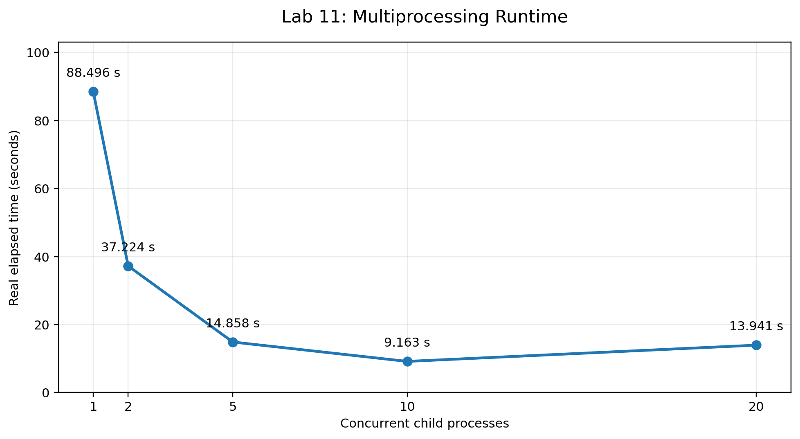

# CPE-2600 — Lab 11: Multiprocessing Mandelbrot Movie

**Student:** Chase Bartelt  
**Course:** Systems Programming, Fall 2026

## Overview

This project generates a zoom animation of a colorful, Mandelbrot-inspired fractal using multiple child processes. The modified `mandel` program creates **100 JPEG frames**, then the frames are combined into an MPEG video with FFmpeg.

The purpose of this lab is to measure how the program's total execution time changes as more independent child processes run concurrently.

## Implementation

- `getopt()` reads command-line options, including `-p` for the maximum number of concurrent child processes.
- The parent uses `fork()` to create a child for each frame. Each child renders its assigned frame and saves it as `frames/mandel0.jpg`, `frames/mandel1.jpg`, and so on.
- Each frame's view is scaled by a factor of **0.92** relative to the previous frame to create a zoom animation.
- The parent counts active children and calls `wait()` when that count reaches the `-p` limit, preventing more than the requested number from running at once.
- The parent also waits for remaining children to finish before exiting. Because each frame is independent, no pipes or other interprocess communication are required.
- The program uses a custom iteration formula and RGB color mapping for its stylized fractal appearance; it is not an exact implementation of the standard Mandelbrot recurrence.

The default render settings are **3840 × 2160 pixels** and a maximum of **10,000 iterations** per point, though both can be changed with command-line options.

## Build and Run

On Ubuntu/WSL, install the required development library and video tool:

```bash
sudo apt update
sudo apt install build-essential libjpeg-dev ffmpeg
```

Build with the included Makefile:

```bash
make
```

Generate 100 frames using up to five child processes:

```bash
./mandel -p 5 -W 640 -H 360 -m 500
```

Useful options:

| Option | Purpose |
| --- | --- |
| `-p N` | Maximum number of concurrent child processes |
| `-W N` | Image width in pixels |
| `-H N` | Image height in pixels |
| `-m N` | Maximum iterations per point |
| `-x N`, `-y N` | Center coordinates |
| `-s N` | Horizontal scale (zoom starting width) |
| `-h` | Display help |

## Movie

The program writes numbered JPEGs to the `frames/` directory. Combine them into a 10-second MPG at 10 frames per second:

```bash
ffmpeg -y -framerate 10 -start_number 0 -i frames/mandel%d.jpg -c:v mpeg2video -q:v 1 -pix_fmt yuv420p mandel.mpg
```

Final movie: [mandel.mpg](mandel.mpg)

## Multiprocessing Performance

### Test method

Each run generates the same **100 frames** using `640 × 360` resolution and `500` maximum iterations. Only the number of concurrent child processes changes. The **real (elapsed)** time reported by the shell's `time` command is used for comparison.

```bash
time ./mandel -p 1  -W 640 -H 360 -m 500
time ./mandel -p 2  -W 640 -H 360 -m 500
time ./mandel -p 5  -W 640 -H 360 -m 500
time ./mandel -p 10 -W 640 -H 360 -m 500
time ./mandel -p 20 -W 640 -H 360 -m 500
```

### Results

These are **real elapsed times** from one run at each process count. Each run generated all 100 frames.

| Concurrent child processes | Runtime (seconds) | Speedup vs. 1 process |
| ---: | ---: | ---: |
| 1 | 88.496 | 1.00× |
| 2 | 37.224 | 2.38× |
| 5 | 14.858 | 5.96× |
| **10** | **9.163** | **9.66×** |
| 20 | 13.941 | 6.35× |

Speedup is `runtime with one process / runtime with N processes`.

### Runtime graph

The graph shows the measured elapsed time versus the number of concurrent child processes. The same data and an editable chart are in `runtime_results.xlsx`.



### Discussion

The results show that multiprocessing reduced the total time required to generate 100 frames, but increasing the number of processes did **not** always improve performance. One process took 88.496 seconds. Two processes took 37.224 seconds, and five took 14.858 seconds. The fastest configuration tested was **10 processes at 9.163 seconds**, approximately **9.66 times faster** than the one-process run.

Increasing from 10 to 20 processes increased the runtime to 13.941 seconds. This may be due to contention for available CPU cores, scheduling overhead, memory use, or file-output activity, although this single trial cannot establish the precise cause.

Overall, independent frame generation benefited substantially from multiple processes, but the best process count depended on available resources. The measurements demonstrate that adding more processes beyond the optimal point can reduce performance. Since each configuration was measured only once, repeating the benchmarks would help quantify ordinary runtime variation.

## Files

| File or folder | Description |
| --- | --- |
| `mandel.c` | Command-line options, child-process scheduling, frame rendering, and color mapping |
| `jpegrw.c`, `jpegrw.h` | JPEG image creation and file output |
| `Makefile` | Builds the `mandel` executable |
| `frames/` | Generated JPEG frames (not committed) |
| `mandel.mpg` | Final movie (included in repository for grading) |
| `runtime_graph.png` | Runtime-versus-processes plot shown above |
| `runtime_results.xlsx` | Raw timing measurements and editable Excel chart |

## Acknowledgments

The starting Mandelbrot and JPEG code was provided for the CPE-2600 Lab 11 assignment; attribution to the original examples is retained in the source file headers.
